# Companion

**See who looted what in Monsters & Memories, and what it was worth, without touching the game.**

*Companion for Monsters & Memories (the project is `MnMCompanion`). Version 0.1.0 was called Loot Goblin.*

<p align="center">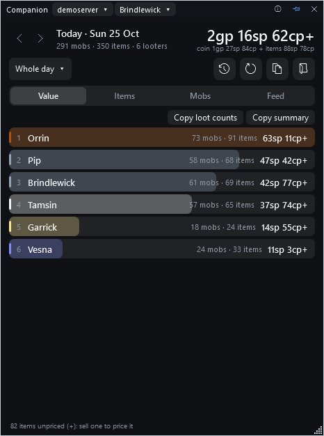</p>

Companion sits beside the game and keeps a running tally of your group's loot: every item and every coin purse, who took it, which
monster it came from, and roughly what a vendor would pay for it. At the end of a night it can tell you exactly who got what.

> **Status: beta, free and open source (MIT).** Everything below works. The program isn't code-signed, so Windows may warn the first time you run it
> (see [Install it](#install-it)). Once installed, it updates itself (see [Updates](#updates); one switch turns that off).

**[Download the latest version](https://github.com/ExploreTheFloor/MnMCompanion/releases/latest)**  ·  Windows 10 or 11, 64-bit  ·  nothing to install  ·  [Questions? Read the FAQ](docs/FAQ.md)  ·  [Report a problem or ask for a feature](https://github.com/ExploreTheFloor/MnMCompanion/issues/new/choose)

[](https://github.com/ExploreTheFloor/MnMCompanion/actions/workflows/ci.yml)

### In a minute

1. Download **MnMCompanion.exe** from the [latest release](https://github.com/ExploreTheFloor/MnMCompanion/releases/latest). If Windows warns you, click **More info**, then **Run anyway**.
2. Run it. A narrow window sits beside the game and **follows the character you're playing**.
3. Loot shows up within seconds. The **History** button in the title bar opens the **History** window: every day, every player, drop rates, vendors, harvests and trades.

---

## Contents

1. [What it does](#what-it-does)
2. [Install it](#install-it)
3. [Your first minute](#your-first-minute)
4. [Finding your way around](#finding-your-way-around)
5. [The History window](#the-history-window)
6. [Sessions: starting a fresh tally](#sessions-starting-a-fresh-tally)
7. [Timers](#timers)
8. [How the numbers are worked out](#how-the-numbers-are-worked-out)
9. [Your privacy, and what it never does](#your-privacy-and-what-it-never-does)
10. [Sharing with the community data](#sharing-with-the-community-data)
11. [Updates](#updates)
12. [Something looks wrong](#something-looks-wrong)
13. [For the curious](#for-the-curious)

More: the [**FAQ**](docs/FAQ.md) answers the common questions in a few lines each, and [docs/ledger-notes.md](docs/ledger-notes.md) is what the game's ledger does and doesn't hold.

---

## What it does

When you play, the game quietly writes a diary of what happens to you and the people around you: items looted, coin picked up, things
sold to vendors, who joined the group. Those diary files are called **ledgers**, and they sit in a folder on your PC. Companion reads
them and turns them into something you can look at:

- **Who looted what**, for you and everyone in your group.
- **Coin and item value** per person, with a share bar so you can see at a glance who is ahead.
- **Which monsters** gave the most, and what they dropped.
- **A live feed** of every loot line as it happens.
- **A full history** of every day, with a page for each player.
- **How often a monster drops an item**, worked out from everything your group has looted ("drop rates").
- **What you sold and bought**, what vendors pay for each item, and how much you made.
- **What you gathered**, how fast, and what it's worth.
- **Your trades**, and what you dropped, picked up or destroyed.
- **A map of the zone you're in**, from the community atlas, which follows you from zone to zone (see [The Map page](#the-map-page)).
- **Every tradeskill recipe of the community wiki**, by skill and by level, with a search box (see [The Recipes page](#the-recipes-page)).
- **Timers** you start with a key, and one on every corpse, all switched off until you turn them on (see [Timers](#timers)).
- **A yes/no choice to add your own numbers to a combined community database** of drop rates and prices (kept privately by the project), and to use it (see [Sharing](#sharing-with-the-community-data)).
- **A copy button** that turns any of it into text you can paste into chat.

It only *reads*. It never touches the game, never reads the game's memory, and never presses a key for you.

---

## Install it

You need Windows 10 or 11 (64-bit). **Nothing else has to be installed.**

1. Open the project's [**Releases** page](https://github.com/ExploreTheFloor/MnMCompanion/releases) and download two files from the newest release:
   - **`MnMCompanion.exe`**, the program;
   - **`MnMCompanion.exe.sha256`**, its checksum (optional, see step 3).
2. Put `MnMCompanion.exe` anywhere you like (a folder on your desktop is fine) and double-click it.
3. *Optional: check the download wasn't damaged.* Open PowerShell in the folder and run
   `(Get-FileHash MnMCompanion.exe).Hash`. The long string it prints should match the one in `MnMCompanion.exe.sha256`
   (capital or small letters doesn't matter).

**Windows may warn you the first time** ("Windows protected your PC"). That happens to any program that hasn't paid for a code-signing
certificate. Click **More info**, then **Run anyway**. If you want to be sure, do step 3 first.

To uninstall, close it and delete the file. Its settings and saved history live in `%LOCALAPPDATA%\MnMCompanion\` (paste that into the
File Explorer address bar); delete that folder too if you want everything gone. If you used it when it was called Loot Goblin, the
first start moves your old `%LOCALAPPDATA%\LootWindow\` folder to that name, so your settings and saved history carry on.

---

## Your first minute

1. Start the game and play a little (or just start Companion; it reads yesterday's loot too).
2. Run **MnMCompanion.exe**. A narrow window appears on the right side of your screen, on top of other windows.
3. At the top left, next to the title, is your **character's name with a small arrow**. If you have more than one character, click it
   and pick the one you want.
4. That's it. Loot shows up within a couple of seconds of being looted, and the window refreshes itself.

If the window says it can't find any ledger, see [Something looks wrong](#something-looks-wrong).

---

## Finding your way around

### The title bar

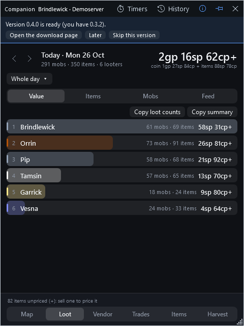

From left to right: the **name** of the program, the **character and server** it is showing, then on the right a **Timers** button (a stopwatch) and a **History** button (a clock),
each with its name beside it (the names drop away when the window is narrow), an **ⓘ** button
(about, updates, the ledger folder, and where the game keeps its data), a **pin** (keep the window on top of the game, or let other windows cover it) and **close**.

There is nothing to pick: this window **follows the character you're playing**. The game rewrites the ledger of whoever is logged in, so when it
starts writing a different character's ledger the window switches to them (and says so in the status line), and when it starts it opens on
whichever character the game wrote last. If you have two games open, it stays on the one it's showing while that one is still being written.
To look at another character, or at all of them together, use the **History** window.
Drag the title bar to move the window; drag any edge or the corner grip to resize it. It remembers where you left it.

When a new version is available, a strip appears under the title bar (picture on the right). More on that in [Updates](#updates).

### The header

Under the title bar you'll see the **day** you're looking at (use the arrows to go back or forward), a big number for the **total worth**
of everything looted, and a smaller line breaking it into **coin** and **items**. Next to the day is a menu that says **Whole day** or
**This session**; see [Sessions](#sessions-starting-a-fresh-tally).

### The bottom bar: seven pages

The bottom of the window has a button for each **page**.

<p align="center">
  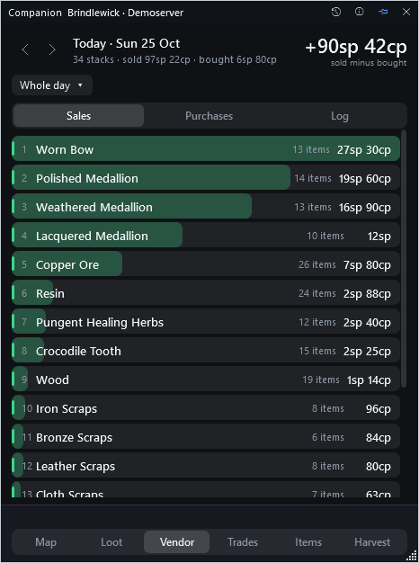
  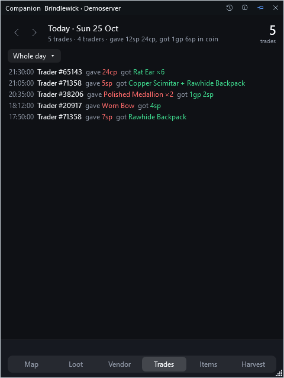
  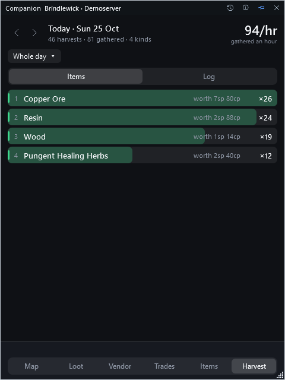
  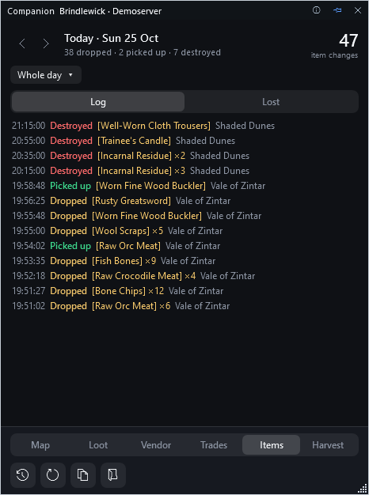
</p>

| Page | Shows, for the day and session on show |
|---|---|
| **Map** | The map of the zone you're in, which follows you from zone to zone. See [The Map page](#the-map-page). |
| **Loot** | Who looted what: the page described above and below. |
| **Vendor** | What you sold to vendors and bought from them, and what you're ahead or behind by. Tabs: Sales, Purchases, Log. |
| **Trades** | Each trade with another player: what you gave and what you got. |
| **Items** | Items you dropped, picked up and destroyed. Tabs: Log, and Lost (what was dropped or destroyed and not picked up again). |
| **Harvest** | What you gathered, how many an hour, and roughly what it's worth. Tabs: Items, Log. |
| **Recipes** | Every tradeskill recipe of the community wiki, by skill and by level, with a search box. See [The Recipes page](#the-recipes-page). It isn't about your day, so it ignores the session. |

**Every page except Recipes shows the same day and the same session.** Choose *This session* (or an earlier one, or the whole day) on one page and they all
follow, so "what did this one run give me?" is the same question on every page. A click on a row of Vendor, Trades, Items or Harvest opens that
page of the History window for the same character.

The **History** button is in the title bar, next to **Timers** and ⓘ: it opens the big window with every day, every page, for this
character or for everyone. **New session** is in the session menu (the *Whole day / This session* chip under the day) and starts every page again
from nothing; the *Copy* buttons are on the Loot page's tabs; **Open the ledger folder** is in the ⓘ menu. The line above the page buttons says what
just happened (a session archived, how many items are unpriced).

### The Loot page's four tabs

| Tab | Shows |
|---|---|
| **Value** | One bar per player: how many monsters they looted, how many items, and what a vendor would pay for **the items they looted**, best first. Coin isn't in it: the game shows only your own share of a split purse, so players can only be compared by items. Click a name to open their page in History, for the session you're looking at. |
| **Items** | Every kind of item looted, how many, what they're worth, and who took the most of them. |
| **Mobs** | Every kind of monster looted, how many times, and what each one is worth on average. |
| **Feed** | Every loot line, newest first, with the time, who, what, and what it came from. A box at the top filters it by player, item or monster. |

<p align="center">
  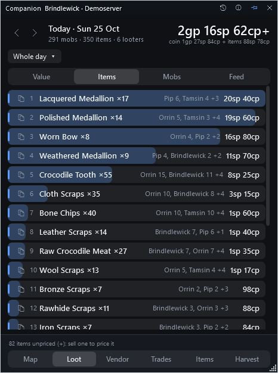
  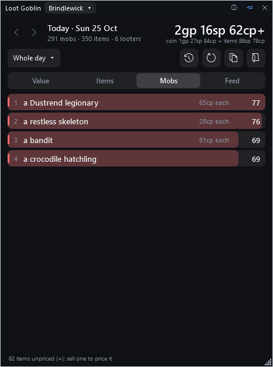
  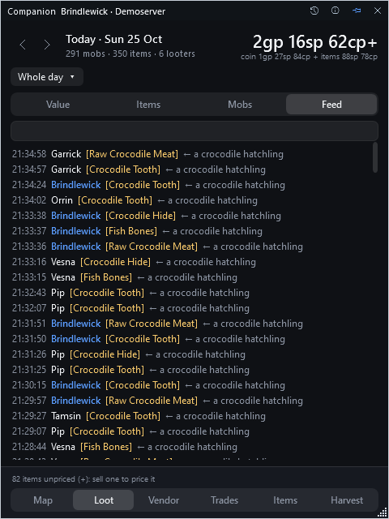
</p>

### The Map page

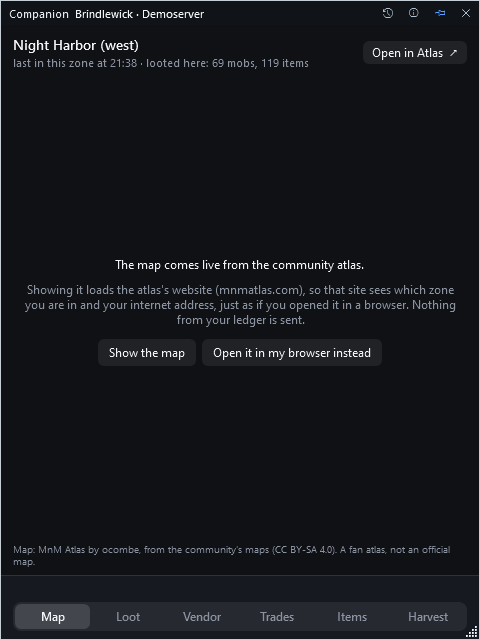

The ledger names the zone on every line it writes, so Companion always knows which zone your character was last in, and the **Map** page shows
that zone's map. When you zone, it follows as soon as the game writes something in the new zone (loot, a sale, something gathered); the ledger
doesn't have a line for zoning itself, so a freshly entered zone shows up a moment later.

The maps are not stored in Companion. They are the **community atlas**, MnM Atlas (mnmatlas.com, made by ocombe, built on the community's wiki
maps), which has vendors, places, hidden areas and zone exits on each map. The page shows the atlas's own map of your zone, with the atlas's
credits visible. Because that loads the atlas's website, **it asks first**: the atlas's site sees which zone you're in and your internet
address, just as if you'd opened it in a browser (nothing from your ledger is sent). Press **Show the map** to say yes (you can change your mind in
the ⓘ menu: *Show the live map of my zone*), or **Open it in my browser instead**, or **Open in Atlas** at any time, which opens the same page in
your browser and nothing else.

The ledger has no positions, so there is no "you are here" dot. It needs the web view that comes with Windows 10 and 11 (Microsoft Edge
WebView2); if that's missing the page says so and the **Open in Atlas** button still works. Maps are by the community (CC BY-SA 4.0); this is a fan
atlas, not an official map, and Companion is not affiliated with it or with the game's makers.

### The Recipes page

The **Recipes** page is the community wiki's list of tradeskill recipes, made easy to read: pick a **skill** (Blacksmithing, Alchemy, Cooking and so on) and its
recipes come in order of **level**, in stretches of 25 levels (*Level 1–25*, *Level 26–50*, ...), each row showing the level, what it makes and what it takes
(*6 Copper Bar, 1 Smithing Pliers*). A stretch folds away when you click its heading, and **Close all / Open all** does every stretch at once. Click a recipe to open the rest
the wiki lists about it (the station, the slot, notes) and a button to copy it as a line of text. Until you pick a skill the page lists them all, with how many recipes each has and
the levels they cover, and what each is made at, who teaches it and which tools it needs is under the skill's name.

The **search box** looks through every recipe at once (or one skill's, when one is picked). Every word you type has to be somewhere in the recipe, in any order and any case, and a part
of a word is enough: *copp bar* finds everything made from Copper Bar, *weapons* finds a whole kind, *zinc* finds anything that takes zinc. Two numbers with a dash are a range
of levels: *50-75*, or *iron 60-90* for the iron recipes between levels 60 and 90. A search that finds exactly one recipe opens it.

A recipe's **level** is the number the wiki lists it at as *trivial*: the skill level where it stops being worth making. Where the wiki doesn't have one yet it shows a **?**
and the recipe goes last. Recipes the wiki has no ingredients for yet say so.

The colours help you read it: a level is coloured by how far into its skill it is (green up to 50, then teal, blue, purple, orange and pink for the highest), the same on the number, the
stripe at the row's edge and the heading of its stretch, so the page reads as a progression from the top. Each skill has a colour of its own on the skill list and the picker, the
amounts an ingredient list asks for are in gold, and the words your search found are marked in the rows.

The recipes are **not** in your ledger, and Companion doesn't carry them: they come from the **community wiki** (monstersandmemories.wiki, a fan wiki), from the public
tradeskills data the wiki's own pages load. **The page loads them by itself** the first time you open it: that contacts the wiki once, so it sees your internet address, just as if
you'd opened it in a browser (nothing from your ledger or your game is sent, only the program's name and version). The list is then kept on this PC (`recipes.json` in Companion's
folder), so the page opens at once and works without the internet, and the wiki is asked again only when you open the page and the kept copy was last checked more than a day ago (or when you press the refresh button, which works once in ten minutes at most). By then the question is only *has your list changed?*, which the wiki answers with nothing at all when it hasn't, and the answer is asked for compressed. Companion remembers when it last asked even after a restart, never asks twice within an hour (not even after an error), and keeps away for as long as the wiki asks it to, so opening the page ten times a day, or restarting, costs the wiki nothing. If you'd
rather it never asked, untick *Load the recipe list from the community wiki* in the ⓘ menu: the page then says loading is switched off, and offers to turn it on or to open the wiki in your
browser instead. The wiki is by its community, can be incomplete or out of date, and Companion is not affiliated with it or with the game's makers.

### Those little symbols after a number

Not every item has a known price (more on that [below](#how-the-numbers-are-worked-out)), so Companion is honest about it:

- **`~`** after a number means *"includes an estimate"*: some items in the total were priced by comparison with similar items.
- **`+`** after a number means *"and some more"*: some items had no price at all and aren't counted.

So `2gp 16sp 62cp+` reads "at least this much." The footer tells you how many items are unpriced.

---

## The History window

Press the **History** button for the big window. Down the left is a **rail** with a page for each kind of thing that happens to you in the game:

| Page | What it's for |
|---|---|
| **Loot** | Who looted what, day by day, and how often monsters drop things. |
| **Trades** | What you gave other players and what you got. |
| **Vendors** | What you sold and bought, and what vendors pay for every item. |
| **Drops / Pickups / Destroys** | Items you put on the ground, picked up, or deleted. |
| **Harvest** | What you gathered, how fast, and what it's worth. |

Under each name on the rail is a small count, so you can see at a glance which pages have something.

### Whose history: the server and character pickers

At the top of the rail are two pickers, **Server** and **Character**. They list the servers and characters the game has folders for on your PC,
so they are always whatever you've actually got (a character that hasn't written a ledger yet is listed too, marked *no ledger yet*).

| Server | Character | What every page shows |
|---|---|---|
| All servers | Everyone | Everything on this PC, all your characters added together. |
| One server | Everyone on that server | All your characters on that server. |
| One server | One character | Just that character. |

The first time you open the History window it shows the character the small window is following; after that it remembers your last choice.
When you're looking at more than one character the log tables gain a **Character** column, and every heading says whose it is.

On the **Loot** page, putting characters together doesn't count anything twice. If two of your characters were in the same group, both
ledgers record what the others looted, so Companion counts an event both of them logged once (it has the same time, looter, item and amount in
each). Characters on different servers are never merged: those are two separate worlds.

### The bar across the top (every page except Loot)

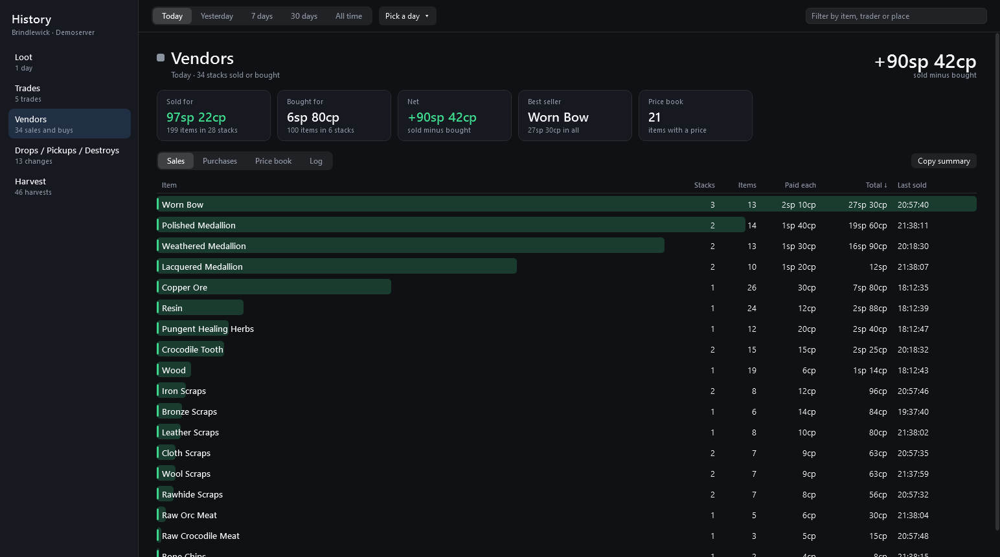

The strip at the top chooses **when**: **Today**, **Yesterday**, **7 days**, **30 days**, **All time**, or **Pick a day** for any single day that has something on it. The box on the right **searches** by item, trader or place, and by **character** when the page covers more than one (type "backpack" and every page shows only rows with a backpack in them; with **Everyone** picked, "orrin scraps" shows Orrin's scraps). Every word you type has to be in the row, in any order and any case, and a part of a word is enough. Your choice stays as you move between pages. Every page also has a **Copy summary** button, and every table sorts when you click a column heading.

### Loot

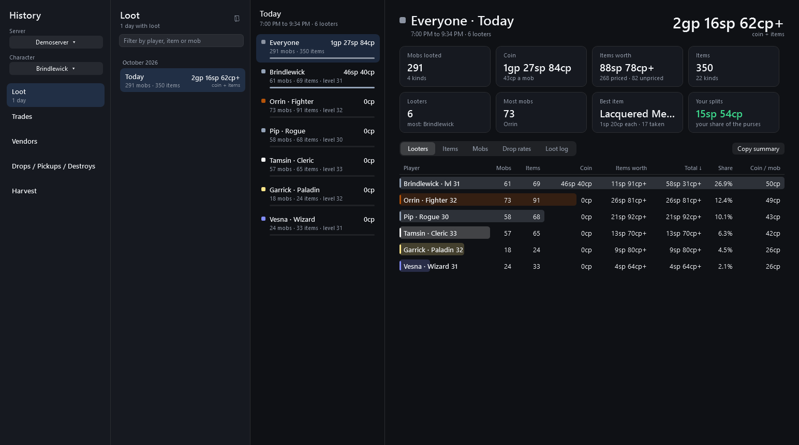

At the top of the Loot tab and of the Loot page are two figures. **Total** is what the whole group looted: every purse once, whole, plus what a vendor would pay for all the items. **Ours** is what reached *you*: your coin (in a group only your shares of the split purses, your own included; the purses you looted alone, whole) plus what a vendor would pay for the items you looted. Each has its coin and items underneath.

The Loot page has three columns:

- **Left: the days.** Every day you have loot for, with the day's total, and a **search box** for a player, item or monster. Typing narrows the days to the ones that have it, and puts an **All days** row first that adds up what was found across *every* day (see below).
- **Middle: the group.** *Everyone* at the top (the total), then each player with a coloured bar and what they looted, worth at vendor prices.
- **Right: the details** for whatever you picked, with tiles for the headline numbers (monsters looted, coin, item value, best item, and "your splits": your share of the coin purses; on your own page also "your coin") and tabs underneath.

Click **Everyone** and the tabs are **Looters**, **Items**, **Mobs**, **Drop rates** and **Loot log**. Click a **player** and you see their own **Items** (how many they took, the price of each, their share of the group's, and which monster they mostly came from), **Mobs** and **Loot log**.

Every list on the Loot page has a **search box** above it: the **Items**, **Looters**, **Mobs** and **Loot log** tabs, a player's **Items** and **Mobs**, and Drop rates → **By monster** and **By item**. Type part of a name and only the matching rows stay ("scraps", or "raw croc meat" for Raw Crocodile Meat). Every word you type has to be in the name, in any order and any case, and a part of a word is enough. It says how many rows match, keeps what you typed while you sort a column or switch tabs, and **Esc** clears it. **Copy items** copies just the items that match.

#### Searching every day at once

Type in the box at the top of the day list ("iron scraps", "orrin scraps", "legionary") and the first row becomes **All days**: pick it (it is picked for you as you type) and the right-hand side is the **answer across every day** you have, for every character you are looking at, not a list of days to open one by one:

- **Tiles:** how many were taken, how many kinds, on how many days, by how many players, from how many kinds of monster, and what a vendor pays for them.
- **Items, Looters, Monsters, Days and Loot log** tabs: what was taken in total and who took it, who took how many (and on how many days), which monsters it came from (corpses, and how many per corpse), a line per day (click one to open that day), and every matching loot line with its date.
- **Click a player** in the middle column to see only their share of the answer.

A word can match the looter, the item or the monster, so "wolf" finds the wolf pelts and everything that came off wolves, and "orrin scraps" finds the scraps Orrin took. Only items are counted (a search is about what dropped, not coin). Clear the box and you are back on the day you had open.

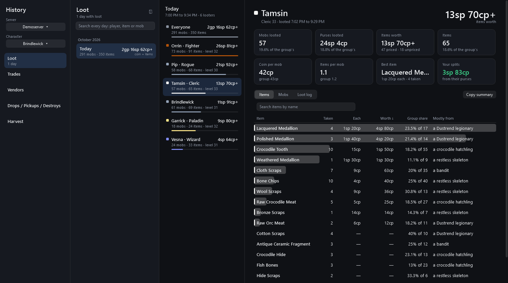

#### Drop rates: "how often does this monster drop that?"

The **Drop rates** tab answers it from everything your group has looted, across **every day** in the ledger (a much bigger sample than a single night).

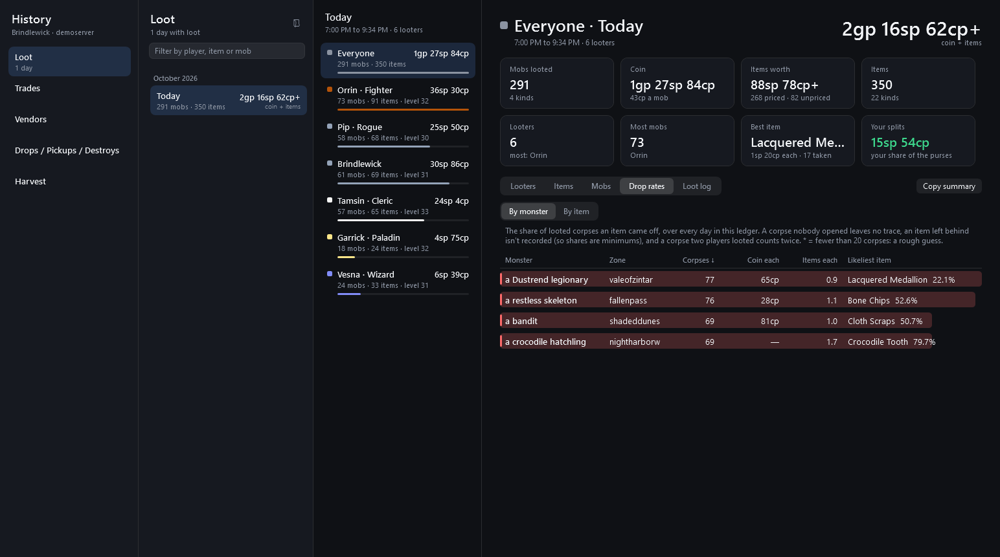

Pick **By monster** or **By item**:

- **By monster:** every kind of monster, with how many of its corpses were looted, the coin and items it gives on average, and its likeliest item. Click one to see **every item it has given**, ranked by how often.
- **By item:** every item, with the monsters it comes from, and a search box to find one by name. Click one to see where to find it.

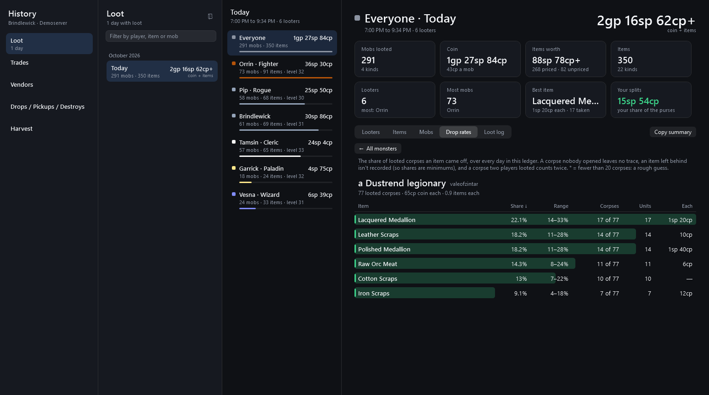

For each item you get a **share** (out of all the corpses of that monster that were looted, how many had the item), a **range** (how sure that share is; it's wide when there aren't many corpses), how many corpses that is, how many items, and what a vendor pays for one.

**Please read this part, because it's honest about what the numbers can and can't be:**

- It's a share of **looted corpses, not of kills.** The game's diary only records what someone *took*. A corpse nobody opened leaves no trace, and an item someone chose to leave behind isn't recorded, so real drop rates are **at least** what you see.
- A corpse that two players both looted counts twice.
- Monsters are kept apart by **zone**, because the same name in two zones can have different loot.
- A **star (\*)** means fewer than 20 corpses were looted. The share is then a rough guess, and the range will tell you so.

### Trades

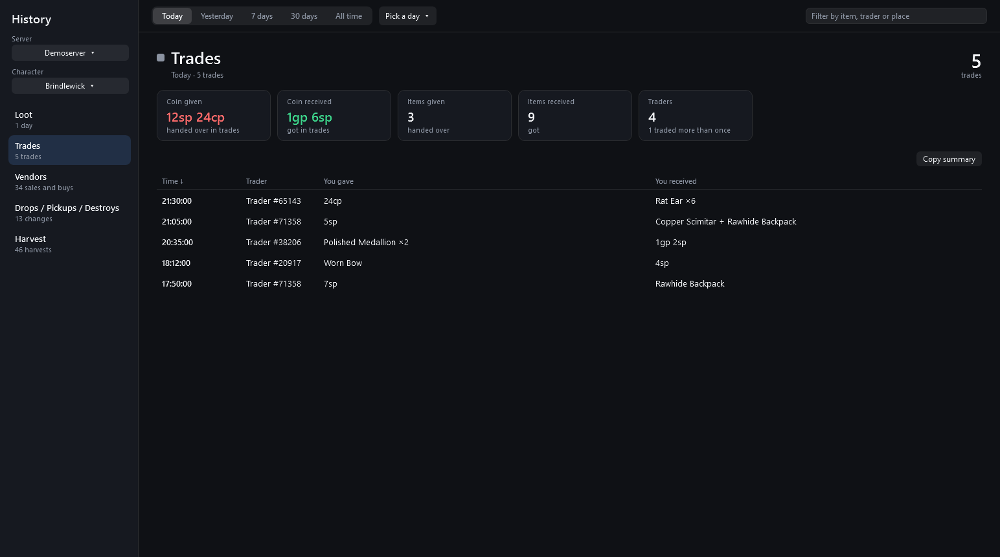

One line per trade: what you **gave** and what you **received**. The game doesn't record the other player's *name*, only a number, so they show as **Trader #71358**. The same number is always the same player, so you can spot repeat customers. (The game writes two entries for each trade, one per side, and they are put back together here.)

### Vendors

The Vendors page has four tabs:

- **Sales:** every item you sold in the period, with how many, the price you got for one, and the total.
- **Purchases:** the same for what you bought (food, water, supplies).
- **Price book:** every price this PC has ever seen, for every character, all time. This is where item values everywhere in the app come from.
- **Log:** every single stack, newest first.

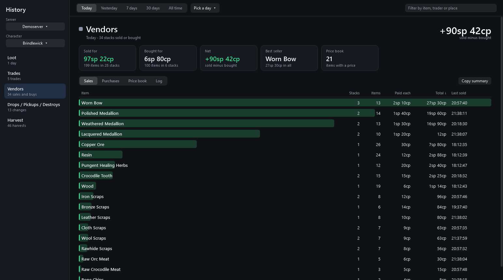

The tiles show **Sold for**, **Bought for**, and the **Net** between them (what the vendors paid you minus what you spent). In the **Price book**, "Pays" is the middle price vendors paid for one, and "Range" is the lowest and highest. Different vendors pay slightly different amounts and tiny prices get rounded, so a range is normal. Sell one of an item you've never sold and it gets a price.

### Harvest

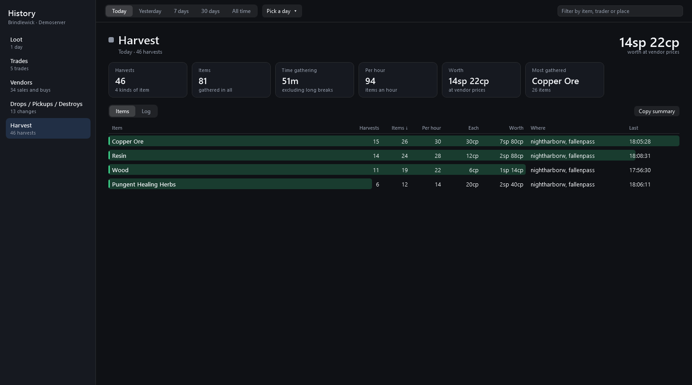

What you gathered: how many harvests, how many items, the **time you actually spent gathering** (a break of more than 10 minutes isn't counted), and so **items per hour**. **Worth** uses the same vendor prices as the loot, with the same `~` (estimated) and `+` (some items unpriced) marks. The game records the item and the zone, but not which node it came from.

### Drops / Pickups / Destroys

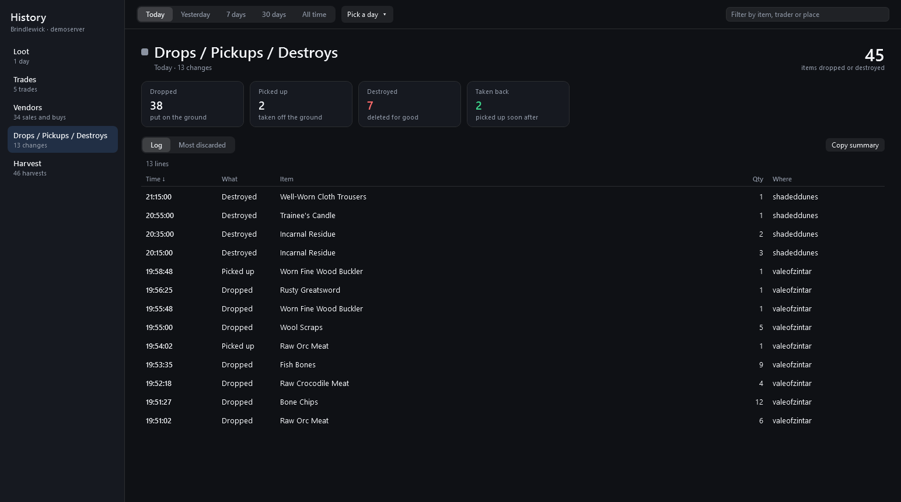

What you did with items you were holding: **dropped** them on the ground, **picked up** things off the ground, or **destroyed** them. None of it is about monsters. It's for answering "where did that item go?" **Taken back** counts the things you picked up within 10 minutes of dropping them. **Most discarded** ranks what's gone for good.

---

## Sessions: starting a fresh tally

A **session** is just "since I last pressed New session", or since the last player joined your group (see below). It's how you answer *"what did we get from this one dungeon run?"* without it being
mixed in with the whole day.

- Press **New session** (or use the **Whole day** menu → *New session*) and Companion saves the old loot tally as a text file and starts every page again
  from zero. **Nothing is deleted**: the game's ledger still has everything, and the *Whole day* view still shows it all.
- Use the **Whole day / This session** menu to switch between the current session, an earlier one, or the whole day.
- Pressed it by accident? Open that menu and choose **Undo the last new session**; the two merge back together.
- The saved text files are in `%LOCALAPPDATA%\MnMCompanion\<server>-<character>\sessions\`.

**A new player joining the group starts a new session by itself.** When another player joins your group, or you join one, Companion archives the loot so far and starts every page again from that moment, the same as pressing **New session** (it does nothing when nothing was looted since the last session started, so several players joining at once make one session). A message at the bottom says so, and **Undo the last new session** takes it back. It is on by default; turn it off under **ⓘ → Start a new session when a player joins the group** and sessions start only when you press the button. It reads the ledger's party rows, which the game writes a little after the fact, so the new session starts at the join and nothing looted since is lost.

---

## Timers

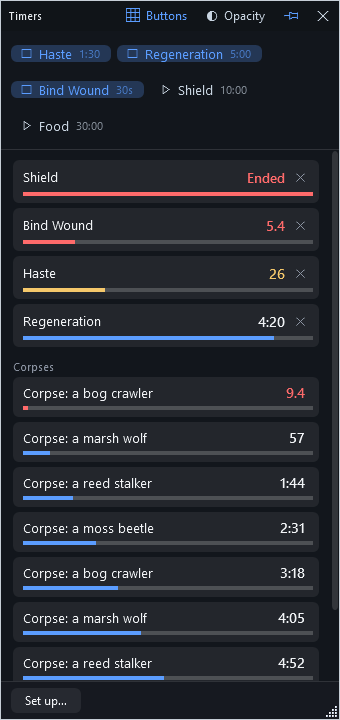

The **Timers** button (a stopwatch) in the title bar opens a small window of timers. **Everything about timers starts switched off**: no timers, no keys, no sounds, no timer on corpses, no row of
buttons, the window not pinned and not faded. Nothing happens until you turn something on. The window holds only the bars of the timers that are
running and one button, **Set up…**, so it takes little room (plus a row of buttons across the top, if you turn on **Buttons**). There are two kinds of timer.

**Timers you name, each with a key and a sound.** Press **Set up…**, name a timer ("Haste"), give it a length (`90`, `1:30`, `5m` or `1h30m`, up to 24 hours) and, if you want, a **key** such as
`Ctrl+Alt+1` and a **sound** for when it ends. Press the key, in the game or anywhere else, and the timer starts counting down; press it again to start it over. A timer with no key starts from its button
(below) or from the ▶ beside it in the setup. Right-click a running timer to start it over, and the **×** stops it.

**Buttons.** Press **Buttons** in the title bar and every timer appears as a button across the top of the window. Click one to start it, and click it again to stop it. A running timer's
button is lit and shows a stop square; one that isn't running shows a start arrow; a right-click starts it over. The switch stays as you left it.

**A timer on every corpse.** Under **Corpses** in the setup, turn on *Start a timer on every corpse* and give it a name, a length and, if you like, a sound. Every monster corpse that is looted,
by you or by your group, then gets its own bar ("Corpse: a bog crawler") that starts at the moment the loot was taken. The window shows the eight ending soonest and counts the rest. It comes
straight from the ledger, so a corpse looted while Companion was closed still shows what is left of its time.

**Sounds.** Pick from the sounds Windows plays for its own events, the alarms and rings that come with Windows, or any `.wav` file of your own. A sound plays when you pick it, so you can
hear it before you keep it. A timer with no sound just ends quietly.

**On top, and see-through.** The window has its own **pin**, off until you press it. Pinned, it stays on top of the game like the main window does (the game has to be in a window or borderless: nothing can
draw over a game that has the whole screen to itself). The **Opacity** button fades the window's background in steps down to 10%, so the game shows through behind it while the bars and the words
stay solid. The title bar never fades away completely, so you can always find the window and drag it.

A running timer shows its time left and a bar that drains. It turns **gold for its last half minute**, **flashes red for its last ten seconds**, and shows **Ended** for a few seconds when
it is over, playing its sound if it has one. Your timers are kept for each character, as the moment they end, in
`%LOCALAPPDATA%\MnMCompanion\<server>-<character>\timers.json`, so they carry on if you close Companion. The **×** in the corner only hides the window: timers keep running (and playing their sounds),
and your keys keep working. Nothing about any of this is ever sent anywhere.

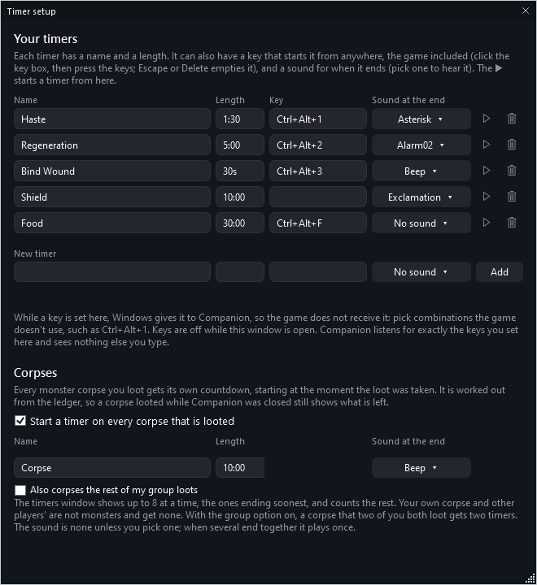

**Companion can't start a buff timer for you.** It only reads the game's ledger and journal files, and the game writes nothing about your casts to either, so it can't know when you cast
a spell: you start those timers, with a key. (It never looks at the game's memory or the screen.)

**About the keys.** A key you set is registered with Windows, so it works while the game has the focus, and Windows then gives that key to Companion: **the game does not receive it while
Companion is running.** Choose combinations the game doesn't use, such as `Ctrl+Alt+1`. For that reason a letter or digit must have Ctrl or Alt with it; F1 to F24 and the keypad keys
can be used on their own. Keys are off while the setup window is open, so you can press one to record it. Companion hears exactly the keys you set and nothing else you type, and it
never sends a key press. If another program already uses a key, Companion says so under the timers. Keys have not been tried under Wine or Proton.

---

## How the numbers are worked out

### Where the loot comes from

The game's ledger records every item and every coin purse that anyone in range looted, along with the name of the kind of monster it came
from. Companion adds it up.

- **Your own loot** comes from your character's own ledger file.
- **Everyone else's** comes from the "social" ledger: what your group and the people around you looted.
- The game also moves older social entries into an **archive** folder from time to time. Those entries exist nowhere else, so Companion
  reads the archive too. (Skipping it would lose about half of what other players looted.)

### What counts as "a mob looted"

The ledger doesn't say *which* corpse something came from, only what kind of monster. So Companion treats one player's items and
purse from one kind of monster, looted within six seconds of each other, as one corpse. It's an excellent guess, not a certainty.

### What coin is worth

100 copper make 1 silver, 100 silver make 1 gold, 100 gold make 1 platinum.

**Who a coin purse counts for.** When someone loots coin, the game may *split* it between the group (their autosplit). Each purse line in the
ledger says which: a purse the looter kept has no split, and one that was divided is marked as split and carries **your** share of it.

- **The group's coin** is every purse counted once, at its whole value. That's the "coin" figure at the top, and the monster's coin on the Mobs tab.
- **A purse that wasn't split** counts, whole, for whoever looted it.
- **A purse that was split** does **not** count for whoever looted it: they kept only part, and the ledger never says how much. Instead
  *your* share counts for **you** (it's the only share a ledger ever shows), even if you looted nothing. What the other members got is unknown, so
  none of it is counted for them. The row's tooltip says how many split purses a player looted.
- **Your own purses in a group.** When *you* loot a purse while you're in a group, your autosplit divides it like anyone's, but the ledger writes it as
  a purse you kept whole (the game's chat says "…and receive 23 copper coins as your split"; the ledger doesn't). So Companion works out whether you
  were in a group (from the ledger's party rows, or from other players' split purses close by) and, if you were, counts the whole purse in the group's
  coin and only your share in yours. That share isn't in the ledger, so it is **estimated** from the fraction you were handed of the nearest split
  purses of other players, and marked with `~`. Looting alone, the purse is yours whole.
- Because only your own coin is known in full, players are **compared by the items they looted**, never by coin: the *Value* tab and the Looters table rank by item value. Your coin is in **Ours** at the top (and as "Your coin" on your page), the group's in **Total**. "Your splits" is your shares added up. "Coin per mob" is what the purses a player looted held, whole.

### What an item is worth

There's no price list inside the game, so Companion works it out **from what vendors actually paid you**:

1. **Seen it sold:** the middle value of what vendors paid for that item (across all your characters on this PC). No mark.
2. **Never sold, but a similar item was:** items whose names start the same way (for example "Rusty Iron ...") sell for about the same, so it
   borrows the family's price. Shown with **`~`**.
3. **Nothing to go on:** left out of the total and marked with **`+`**.

Sell one of an unpriced item to any vendor and from then on it's priced, for every character. You don't have to do anything else.

The price is *what a vendor pays*, not what another player might pay. It's a floor, not a market value.

---

## Your privacy, and what it never does

**It reads files. That's all.** Companion:

- reads two things the game writes, its ledger files and each character's journal (what NPCs have said to you), and nothing else it writes;
- **never** touches the running game or its memory, and never sends a key press or moves your mouse. The only keys it listens for are the ones *you* set for timers (see [Timers](#timers)); it can't see anything else you type;
- **never** sends your loot, your characters, your ledgers or anything about you anywhere, **unless you answer Yes** to sharing your data with the community (below), and even then only anonymous totals, never names;
- installs nothing but its own newer versions, from this project's GitHub releases, and only after checking the download against the checksum published with it. You can switch that off, and then updates are only *offered* (see [Updates](#updates)).

The **journal** is a folder the game keeps for each character, `<character>\journal`: one text file per NPC, named for them, with everything that NPC has said to you (quest text and so on), each line stamped with the time. Companion reads those files too and keeps every line in its own saved database, one NPC once however many characters met them, and lined up with the monsters it has seen looted (an NPC who is also something you killed is marked as such). It doesn't show them on a page yet. It never opens anything else in that folder.

The one thing it does over the internet by itself is ask GitHub *"is there a newer version of Companion?"* (see [Updates](#updates)), and fetch it when there is. That's a plain
request that carries only the program's name and version number. You can switch the installing off, or the asking too.

Only if you answered **Yes** to sharing, it also talks to the project's small community service (see [Sharing](#sharing-with-the-community-data)): it sends your totals, and asks for community figures by name, always with your random id and nothing else about you.

The other exception is the **Map** page, and only if you say yes: it shows the community atlas's map of your zone, which loads mnmatlas.com, so that site
sees your zone and your internet address (see [The Map page](#the-map-page)). Until you say yes, nothing is loaded, and "Open in Atlas" only opens
your own browser when you press it.

The **Recipes** page is another: the first time you open it, and then at most once a day when you open it again, it asks the community wiki (monstersandmemories.wiki) for its public tradeskills list (once you have it, only whether it has changed), with
only the program's name and version, so that site sees your internet address (see [The Recipes page](#the-recipes-page)). It is on by default, and one tick in the ⓘ menu switches it off;
then the wiki is never asked.

The other players' names you see in the group come from your own ledger files; they never leave your PC.

**What it saves on your PC**, all in `%LOCALAPPDATA%\MnMCompanion\`:

| File | What |
|---|---|
| `settings.json` | Where the windows sit, which page you were on, what the History window was looking at, whether to check for updates, whether to show the live map and whether to load the recipes (and which skill you were on). |
| `recipes.json` | The wiki's recipe list, kept so the Recipes page works offline (unless you switched loading it off). Public data from the wiki, nothing from your game. |
| `recipes.meta.json` | When the wiki was last asked and what its answer's version tag was, so Companion keeps to once a day (and to the wiki's own "wait") even after a restart. |
| `<server>-<character>\` | Your session markers and the text files for archived sessions. |
| `ledger.db` | A private copy of **every ledger row** the app has read (see below). |

### The saved copy (`ledger.db`)

The game moves old rows out of its files and may delete files over time, so Companion keeps its own permanent copy of everything it reads,
in a small database file. It includes **every kind of entry** (loot, harvests, vendor sales and purchases, trades, level-ups, group changes,
and entries nobody has identified yet), for **every server and character** on the PC. Nothing in it is ever changed or deleted, and
nothing leaves your PC.

The History window's **Trades, Vendors, Drops / Pickups / Destroys and Harvest** pages read from it (the small panel and the Loot page read
the game's files directly). It's also there for views still to come, built from your own complete history. What the entries mean, and
how to look inside the file, is written up in [docs/ledger-notes.md](docs/ledger-notes.md).

---

## Sharing with the community data

The game's diary tells each player only a little about how the world works. Pooled across many players it tells a lot: how often each monster drops each item, what vendors really pay, what gathering yields. That is what the **community data** is: one combined database of drop rates, prices and gathering yields, built from the totals players choose to share. **It is kept privately by the project and is never published**: there is no download. The source code of this program is public, so you can read exactly what it sends.

**It's one question, Yes or No: "Share my data with the community?"**

| | **Yes** | **No** (the default) |
|---|---|---|
| Your totals | shared **for you, automatically**, and kept up to date | stay on your PC; **nothing is sent** |
| Community data | **you can use it** | **the app doesn't download or show it** |
| Being asked | not again, unless what is shared grows (see below) | **every time you start the app**, until you say Yes |

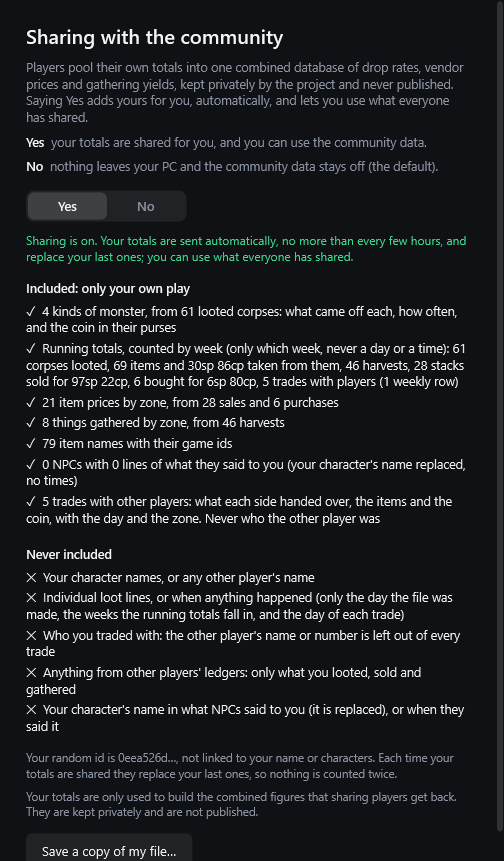

The first time you start the app (and every time after, while the answer is No) a small window asks. **Yes** turns sharing on and it stops asking. **No**, or closing the window, keeps everything private and asks again next time. You can change your answer at any time: click the **ⓘ** in the title bar and tick or untick **Share my data with the community**.

**What gets shared is only your own play** (totals, and your trades with other players), shown to you in full before you decide (**ⓘ → What does sharing include?**, or the **What is shared** fold-out on the question):

- how often each kind of monster you looted dropped each item, and the coin in its purses;
- what vendors paid and charged you, per item and zone (the game doesn't record which vendor);
- what you gathered, per item and zone;
- item names with the game's own ids;
- what NPCs said to you, as distinct lines with your own character's name replaced by `{player}`, in the order you first heard them (so a quest's lines stay in sequence), with no times and no characters;
- **what you dropped and destroyed**, per item and zone: how many units, and how many of the dropped ones you picked up again within ten minutes;
- **running totals, counted by week**: how many corpses you looted (the game doesn't record kills, so this is the kill count), the coin in their purses, the items taken, what you gathered, how many stacks you sold to and bought from vendors and for how much coin, and how many trades you made with other players. These are kept as one row for each of the last 53 weeks plus one row for everything older, so they never grow into a list of events. A week is only its Monday's date, never a day or a time;
- **your trades with other players**, one line for each (the newest 3,000): the **day** it happened (never the time of day), the zone, the server, and what each side handed over: the coin, and the items with how many. The ledger gives the other player only as a number, and **that number is left out**: nothing in the file says who you traded with;
- **which server each of those is from**, by the game's own name for it (the name of the folder the game keeps for that server). Every row above except the item names and what NPCs said (the game's own text, the same on every server) says which server it is from, so the combined figures can be kept per server: what players pay each other, in particular, differs between servers. The running totals are the sum over all your servers. The server name is the world's name, not yours: it is not linked to your name or characters, and the file still has no character names.

It **never** contains your character names, any other player's name or number (not even for a trade), individual loot lines, or the time of day of anything (only the day the file was made, which weeks the running totals fall in, and the day of each trade). The NPC lines carry no time and no character, and your own character's name in them is replaced by `{player}`. Other players' loot is left out on purpose, so a corpse isn't counted once per party member. It's filed under a random id made on your PC, which isn't linked to your name or characters; each time your totals are shared they **replace** your last ones, so nothing is counted twice, and you can have yours removed: open an issue with the [**Remove my shared data**](https://github.com/ExploreTheFloor/MnMCompanion/issues/new/choose) form and give the first eight characters of your random id (the sharing window shows it).

**A Yes covers what you were shown.** If a new version shares more than the one you said Yes to (the weekly running totals were the first such addition, the trades with other players the second, and the server each row is from the third), your earlier Yes no longer covers it: sharing pauses, the question comes back saying what was added, and nothing is sent until you say Yes again.

**No means no community data:** if the answer is No, nothing is sent, and Companion doesn't ask for or show the combined figures.

**Where it goes.** A Yes sends your totals to a small service run by the project, on Cloudflare's network. Like any website, it sees your internet address while you send; the project does not store it. The totals are only used to build the combined figures, which sharing players get back inside Companion. They are not published.

**How it works.** With a Yes, Companion sends your totals a short while after it starts and then every few hours (the service takes one file per id every 6 hours, and a newer file replaces the older one), and not at all when nothing has changed since the last send. The sharing window (ⓘ → What does sharing include?) says when the last one went. Community figures appear in History → Loot → Drop rates: open a monster and a **Community** column shows the middle of the community players' shares, and an item's page shows what the community says vendors pay. A figure is shown only where at least 3 players stand behind it, so there may be none for a while. Nothing here is sent or asked for on a No. `MnMCompanion.exe --contribute <folder>` saves exactly what would be sent (the totals, and what NPCs said to you as a second small file), laid out so you can read it.

---

## Updates


A few seconds after it starts, and every six hours while it's running, Companion asks GitHub whether a newer version has been released. **If there is one, it installs it by itself**,
unless you have switched that off:

1. It downloads the new program and **checks it against the checksum published with the release**. If anything doesn't match (a damaged or swapped download), it throws the download away,
   keeps your current version, and says why in a strip under the title bar.
2. It replaces the old program and restarts into the new one. **If one of your own timers is counting down it waits until none is**, so no timer's end is missed during the restart.
   The strip says so and has **Restart now** and **Not now**. (Your timers, keys and windows are all there again after the restart.)
3. After the restart a strip says which version you have now, and where to switch automatic updating off.

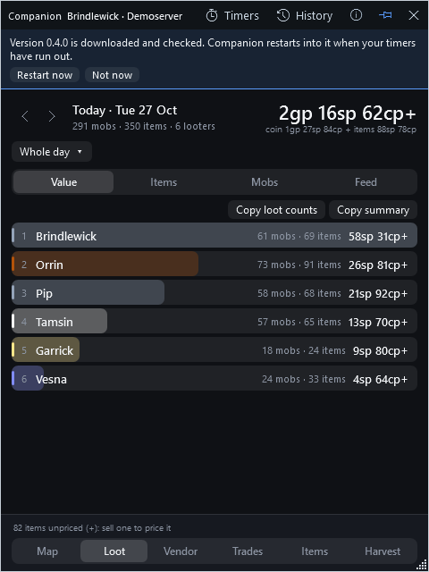

**To be asked first instead:** click the **ⓘ** in the title bar and untick **Install updates automatically**. A newer version is then only offered, in a strip that says

> **Version 0.4.0 is ready (you have 0.3.0).**   `Update now`   `Later`   `Skip this version`

- **Update now** does what the automatic update does (download, check, replace, restart).
- **Later** hides the strip until the next check.
- **Skip this version** stops it being offered again, and also stops it being installed by itself. A newer one after it still will be.
- Hover over the message to read the release notes.

**To never ask GitHub at all:** untick **Check for updates automatically** as well. **Check for updates now** is there whenever you want to look.

The checksum comes from the same release page as the program, so it protects against a damaged or swapped download, not against someone who controls this project's GitHub account.
If you would rather read every change before you run it, switch the automatic install off: the source is public and you can build it yourself (see [Building it yourself](#building-it-yourself)).

If you run Companion from somewhere it can't replace itself (a read-only folder, say), it can't install by itself either: the strip's button becomes **Open the download page**.
A new version that comes out the same as the one before is never installed twice in a row, so a bad release can't make it restart over and over.

---

## Something looks wrong

**The window says it can't find a ledger, or my character isn't in the list.**
Companion looks in `C:\Users\<you>\AppData\LocalLow\Niche Worlds Cult\Monsters and Memories`. Click the **ⓘ** in the title bar, then
**Choose the game's data folder…** and point it at that folder (or wherever your game keeps its data). A character with no ledger yet
is still listed (marked *no ledger yet*): the game writes the file as you loot, sell, level up and so on, and the window picks it up by itself.

**"I don't see my old loot!"**
You probably pressed **New session**. The window then shows only the *current* session. Open the **This session** menu and pick
**Whole day** (or **Undo the last new session**). Nothing was lost.

**Some of my items show no price, or a `~`.**
See [What an item is worth](#what-an-item-is-worth). Sell one of that item to a vendor and it will be priced.

**The totals don't match what I remember.**
Prices are *what a vendor pays*, not what you could sell for to a player, and coin splits are only known for your own share. The
corpse count is an inference (see above). Totals with a `~` or a `+` are estimates.

**Windows says "Windows protected your PC".**
Normal for an unsigned program. **More info → Run anyway.** To be sure the file is the one that was published, check its checksum
([Install it](#install-it), step 3).

**My antivirus complained.**
Single-file programs like this one sometimes get flagged by cautious antivirus software. If you'd rather not run a downloaded program,
you can build it yourself from the source (below).

**The window is on the wrong monitor, or off the screen.**
It pulls itself back onto the desktop when it starts. If it's on the wrong screen, drag it by the title bar.

**It hasn't updated and there's a newer version.**
Click **ⓘ → Check for updates now**, and make sure **Check for updates automatically** is ticked. If you are still on version 0.1.0 (when it was called Loot Goblin), that
version can't see newer releases at all: download the current `MnMCompanion.exe` from the Releases page once and replace the old file (your settings and history are kept);
from then on it updates itself.

---

## For the curious

### Command-line options

Run these from a command prompt or a shortcut. None of them is needed for normal use.

| Option | What it does |
|---|---|
| `--ledger <folder>` | Read the game's data from somewhere else (a test, a demo, a copy). Such a run keeps its own saved copy and saves no settings, so it can never mix into your real history. |
| `--character <name>` | Start on this character. |
| `--history` | Open the History window as soon as the app starts. |
| `--mini <page>` | With `--snapshot --window`: draw this page of the small window (Map, Loot, Vendor, Trades, Items, Harvest or Recipes). |
| `--recipes <file>` | With `--snapshot --window --mini Recipes`: read the recipes from this file (the wiki's tradeskills JSON) instead of asking the wiki; `--tab "<skill>"` picks a skill and `--search "<words>"` types a search. |
| `--share` | Open the "Share my data with the community" window as soon as the app starts. |
| `--no-share-prompt` | Start without asking the sharing question (for scripts and pictures). |
| `--contribute <folder or file>` | Save what sharing would send (named by your random id: the totals, and what NPCs said to you as a second `.npcs.json` file) and quit, without a window. |
| `--archive [--db <file>] [--report <file>]` | Copy every ledger row into the saved database once, write what it did to a report file, and quit without showing a window. |
| `--diagnose [--report <file>]` | Write a report of what this copy sees of where it runs (is it under Wine or Proton, where it looked for the game's data and what it found, whether a window can be drawn), with counts but no names and the user name in paths hidden, and quit. For testing on Linux. |
| `--about [--report <file>]` | Write the version, whether this copy can update itself, and where its files are, to a file, and quit. |
| `--snapshot <png> [--view Value\|Items\|Mobs\|Feed] [--day yyyy-MM-dd] [--size WxH] [--window [--preview-update]]` | Draw the panel to a picture and quit (how the pictures in this README were made). |
| `--snapshot <png> --breakdown [--page Loot\|Trades\|Vendors\|Changes\|Harvest] [--member <name>] [--tab <tab>] [--drop "<monster>"] [--size WxH]` | The same for the History window: any page, any tab, or one monster's drop table. |

To try it without the game, `scripts/make-demo-ledger.py` writes a made-up game folder full of invented players:
`python scripts/make-demo-ledger.py demo-data`, then `MnMCompanion.exe --ledger demo-data --character Brindlewick`.
`scripts/make-screenshots.ps1` uses that to remake every picture in this README (nothing appears on your desktop and no real player is shown).

### Building it yourself

You need the [.NET 10 SDK](https://dotnet.microsoft.com/download).

```
dotnet build MnMCompanion.sln
dotnet test  MnMCompanion.sln
src\MnMCompanion\bin\Debug\net10.0-windows\MnMCompanion.exe
```

A run from the source folder can't replace itself, so it will send you to the download page instead of updating.

`LOOTWINDOW_REAL_LEDGER=<character>` makes one test read that character's real ledger and print what it found, for comparing against counts made
straight from the files.

### Making a release

1. Raise `<Version>` in `src\MnMCompanion\MnMCompanion.csproj` (for example `0.3.1`), commit and push, and wait for CI (the build and tests on every push) to pass.
2. Push a tag with the same number: `git tag -a v0.3.1 -m "Companion 0.3.1" && git push origin v0.3.1`. The [release workflow](.github/workflows/release.yml) builds the
   program on GitHub's own machines, runs the tests, checks it starts and reports that version, writes `MnMCompanion.exe.sha256` and publishes the release `v<version>` with
   both files attached. The app's update check looks for exactly those two file names. (Write the release notes afterwards with `gh release edit v0.3.1 --notes-file <file>`.)

The same can be done by hand: `scripts\build-release.ps1` runs the tests, builds the single-file `MnMCompanion.exe`, writes the checksum beside it in `dist\` and checks the
built program starts; add `-Publish` to create the release (`scripts\build-release.ps1 -Publish -Notes "What changed"`).

### How the project is laid out

```
src/MnMCompanion.Core     reads the ledger and works out the loot, drop rates and histories (no windows, no packages)
src/MnMCompanion.Data     the saved database and the history tables built from it (the only project that may use SQLite)
src/MnMCompanion.Update   asks GitHub for a newer version and downloads it, checked against its SHA-256, and talks to the community service
                        (the only project that may use the network: GitHub, the map's atlas if you say yes, the recipe wiki unless you switch it off, and the community service if you say Yes)
src/MnMCompanion          the Windows app: the small window and its pages, the History window and its pages, the update banner
                        (the only package it has is Windows' web view, for the Map page)
tests/MnMCompanion.Tests  the automatic tests
scripts/                build-release.ps1, make-demo-ledger.py, make-screenshots.ps1
.github/workflows/      ci.yml (build and test on every push) and release.yml (builds and publishes a release from a version tag)
docs/                   ledger-notes.md (what the ledger holds), images/
```

A few tests exist purely to keep the promises above: they fail the build if any source file reaches for the game, someone else's
database, or the network, anywhere except the projects that are allowed to (and the app may carry one package: the web view that shows the
map, only once you've said yes). The recipe wiki is asked for by the update project alone, with one request to one address. Updating, checksums, and swapping the program in (and
back out if the new one won't start) are all tested without a network.

### Not yet

- There is no combined "net" figure across pages. The ledger records your own coin purses whole even when you're in a party, so
  adding them to vendor sales would mislead. The Vendors page shows sold, bought and net *from vendors*, which is certain.
- The Loot page and the small panel still read the game's files directly; they could move onto the saved copy later.

### Licence

MIT: see [LICENSE](LICENSE). The maps on the Map page are not part of this project; they belong to the community atlas (CC BY-SA 4.0).
